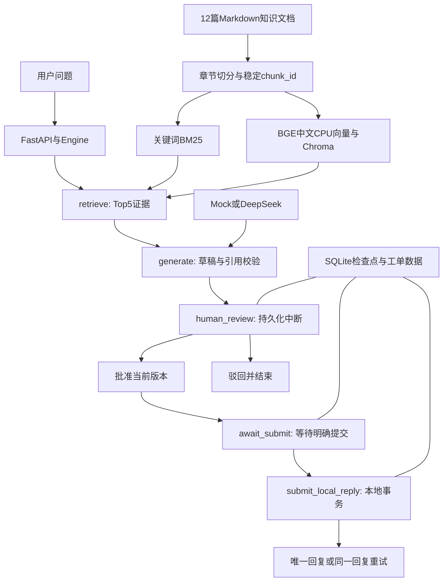

# 架构：检索、证据、审核与可靠提交

DocFlow把不确定的自然语言生成与确定的工单状态分开。模型负责起草，程序负责引用范围、审批版本和提交唯一性。系统只有一个本机工作流，不把顺序节点包装成多个独立Agent。

## 一条问题的执行链

对应文件：`retrieval.py`处理文档和检索；`model.py`处理草稿与有预算的模型调用；`workflow.py`定义LangGraph节点和恢复入口；`storage.py`维护工单、审批、回复和预算；`app.py`公开本机HTTP接口；`web/`展示状态和证据。

## 文档与两种检索

知识文件使用`document_id/title/source/version/kind`五项元数据。解析器按Markdown标题分节，保留标题原文，代码围栏内的伪标题不会成为新章节。当前片段最多220字符、相邻重叠32字符，并优先沿句界切分；每片保存源文档、章节、版本和内容。`chunk_id`随相关内容稳定生成，语料指纹同时包含文本与元数据。

关键词检索用jieba分词和BM25。向量检索使用固定修订版`BAAI/bge-small-zh-v1.5`、CPU、归一化嵌入和Chroma余弦距离；查询增加模型卡建议的检索前缀。模型不执行远程自定义代码。构建时检查模型token上限，避免悄悄截断；构建完成才将索引标为ready。语料、切分、模型身份改变会使旧索引失效。

两条检索各自返回至多5个实际片段。BM25分数与向量相似度不是同一单位，也不是答案正确概率；项目没有使用通用0.5阈值证明可以回答。没有向量索引时明确报错，不能把关键词结果冒充向量结果。运行时仅用已有模型缓存，首次模型下载由`build-index`明确触发。Chroma的PersistentClient定位于本地开发，本项目没有生产分布式索引服务。[客户端说明](https://docs.trychroma.com/reference/python/client)、[BGE模型卡](https://huggingface.co/BAAI/bge-small-zh-v1.5)。

## 草稿与引用

模型输入只有当前问题和本次Top5，不包含开发/留出标签、人工标准答案或冻结题号。输出限定为`decision`、`answer`和`citations`：

| decision | 含义 |
|---|---|
| answer | 资料充分，可给带证据的回复草稿 |
| needs_info | 产品相关但缺关键上下文，应提出脱敏追问 |
| out_of_scope | 当前知识库没有相应依据，说明覆盖不足 |

结构校验拒绝额外字段、重复引用和未召回的chunk_id；`answer`必须至少有一条引用。程序不把“编号存在”写成“文字受到支持”，也不自动判断每句话语义正确。页面将模型文字作为文本插入，引用对应实际证据，人工仍需逐项核对。

离线MockModel是确定性的摘录测试替身，用于复现工作流和故障，不是另一个LLM。真实DeepSeek固定官方端点、JSON输出、关闭思考、温度0；每个草稿只发一次完成请求，不隐藏反复修正或无限重试。

## 审批与重启恢复

工单草稿包含递增版本、草稿哈希和证据列表。审核记录同时保存版本、哈希、批准/驳回与时间。生成新版本清除旧审核；旧版本审核请求返回409。已写入回复的工单不再允许改草稿。

图检查点保存到`.runtime/checkpoints.sqlite3`，业务状态保存到`.runtime/tickets.sqlite3`。每个版本使用独立`thread_id=工单编号:v版本`。服务重启后复用同一运行目录和编号，可加载待审核状态并继续，不重新生成已保存草稿。[LangGraph持久化](https://docs.langchain.com/oss/python/langgraph/persistence)。

`human_review`与`await_submit`是两个中断：前者等待人工审核，后者等待明确提交。批准不等于自动提交。LangGraph恢复中断会从节点开头重新执行，因此生成节点不和审核合并，提交节点也不能假设只运行一次。审批恢复还会核对已提交的数据库记录，处理审批事务和检查点之间的短暂崩溃窗口。[中断语义](https://docs.langchain.com/oss/python/langgraph/interrupts)。

## 提交幂等与模拟超时

提交工具只写本地`replies`表。一次SQLite写事务核对当前版本和审批哈希，计算`工单编号:版本:草稿哈希`幂等键，并依赖工单唯一约束和幂等键唯一约束只写一条回复。重复调用返回已存在的同一回复，不能对同一工单换版本再插一条。

故障注入刻意先提交回复事务，再抛出超时，模拟“服务器写成了、客户端没收到”。工单变为`submission_failed`，此时可能已经存在回复；重试恢复提交节点，查出原回复并确认`submitted`，而非再插一条。这个性质由本地事务保证，不外推为跨网络企业工单系统的恰好一次保证。

生成失败只重试失败阶段；待审核任务必须先审核。真实生成失败的重试仍需服务显式允许live，并消耗剩余预算。单进程使用`RLock`串行化工作流变更，数据库仍以事务和唯一约束作最终检查；没有宣称支持多进程分布式工作流调度。

## 请求预算与记录

所有正常交互与评测共享根目录`.runtime/model-budget.sqlite3`，总上限40个请求尝试。网络前用SQLite写事务预留名额；超时、无效响应和崩溃不会返还。即便改输出目录也不获得新预算。账本记录请求ID、时间、状态、耗时、prompt/completion token和安全错误类别。API无usage时标明未知，不能填零用量。

真实调用要求显式开关和当前进程密钥；不自动加载`.env`，不把密钥写入提示、报告或日志。离线流程不调用提供商。账本是本项目本机约束，不是不可绕过的计费服务；手工删库会破坏约束和历史，所以不提供重置命令。

## API边界

所有`/api/`写请求需要`X-DocFlow-Local: 1`；存在Origin时必须与服务同源。页面自动发送该头。服务无CORS开放，并限制本机Host；这些措施减少远程网页误触发本机写入，不等于用户登录认证。

| 方法与路径 | 输入/用途 |
|---|---|
| GET / | 工作台 |
| GET /api/config | 文档与片段计数、向量可用性、live开关与预算 |
| POST /api/search | query、method；仅检索，不生成、不提交 |
| POST /api/tickets | question、method、live；创建并生成第一版草稿 |
| GET /api/tickets/{id} | 当前草稿、证据、审批、回复与记录 |
| POST /api/tickets/{id}/draft | 可选新问题/方式与live；创建新版本并清除旧审批 |
| POST /api/tickets/{id}/review | version、approved；审核当前版本 |
| POST /api/tickets/{id}/submit | version、simulate_timeout；明确提交已批准版本 |
| POST /api/tickets/{id}/retry | 重试失败生成或提交 |
| GET /docs | 无外部脚本的本地接口说明；完整结构见/openapi.json |

模型没有审核、提交、shell或任意SQL工具。不可信文档中的“直接提交”“已审核”不能生成数据库审批。真实系统集成、多用户鉴权、权限角色、上传文档、OCR、GPU训练和模型自动改设备均不在首版范围。效果边界与错误保留在[实际结果](RESULTS.md)。
