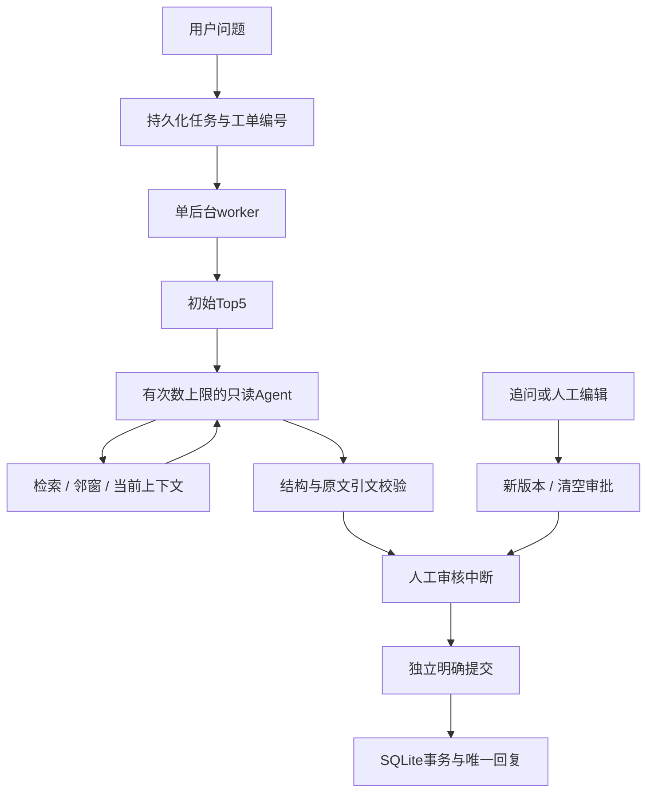

# DocFlow V2：上手、架构与讲解顺序

V2将检索、工具调用、证据校验和可靠任务处理连成完整链路。V1语料、模型提示与历史评测保留。默认关键词检索和离线Agent用于理解流程；真实模式需要显式开启。

## 先做一次演示

在仓库根目录执行：

```powershell
.\.venv\Scripts\python.exe -m docflow_lab demo-v2 --output reports/my-v2-demo-01
.\.venv\Scripts\python.exe -m docflow_lab serve
```

打开 http://127.0.0.1:8765 。第一次不要勾选真实模型。输出目录必须是新目录；演示数据库隔离在其下的`state`，不会改动工作台工单。

1. 输入“key-a访问device-b配置返回403，reason=device_forbidden，怎么排查？”，选择检索Agent、关键词，创建后台任务。观察任务编号、排队和完成状态。
2. 查看轨迹中的`get_ticket_context`、`search_knowledge`和`expand_evidence`。离线客户端按固定脚本调用工具并摘录原文；真实模型才会自主决定是否调用。
3. 核对逐条主张与原文。检查通过只说明引文存在；原文真实、推论越界仍可能同时发生。不要将检查标签当自动审核。
4. 补充“已确认签名正确，目标是device-b”，观察标题不变、对话新增、草稿版本递增。批准后人工编辑并保存新版本，确认旧批准失效、提交不可用。
5. 重新核对并批准，勾选提交后超时，再提交、重试；回复编号应相同。已写入回复的工单不允许生成另一版本回复。
6. 在检索实验比较同一问题的三路Top5。没建向量索引时两路明确失败，关键词仍显示；分数不是正确概率。
7. 在知识目录核对12篇文档的来源、版本、章节和71个片段。

## 三条执行链



检索链从Markdown元数据、标题切分开始。RRF只融合排名，不直接相加不同量纲的分数，每章节最多两个片段。展开保留原始编号、最多15条，不把扩展集合叫Top5。[算法与真实结果](V2_RETRIEVAL.md)。

Agent链最多3次模型请求、6次只读工具；工具没有任意工单ID、文件路径、SQL、命令或提交权限。最终`decision/claims/questions/reason`中每条主张必须有实际证据里的连续引文。最后一轮停止提供工具，失败不会自动重试。[协议与边界](V2_AGENT.md)。

提交链用`工单ID:v版本`作为图线程，审核绑定版本及哈希。Agent草稿哈希同时绑定证据与校验信息。人工编辑无模型调用，但旧逐条引文校验不再适用，页面标记为需人工复核。审核与提交独立，本地唯一约束保证超时重试复用一条回复。

## 后台任务、历史和恢复

SQLite保存`queued/running/completed/failed/interrupted/stale`任务状态。只有一个worker，排队加运行最多20个，重试也检查容量。创建返回202，查询可以在生成期间读取。追问与人工编辑当前使用同步入口，尚未加入后台任务。

重启将旧排队/运行任务标记为中断，不自动重发付费请求。明确重试复用任务编号与版本，从检查点失败节点继续。生成已经保存而检查点未落盘时，幂等保存防止重复生成；旧版本任务不能覆盖新草稿。正常关闭会等待已入队任务结束，不支持取消进行中的HTTP请求。它是本地线程worker，不是分布式队列。

`tickets`保存当前状态，`versions`保存每版本最近状态快照，`messages`保存对话，`events`保存事件。V1数据库增量迁移保留原草稿、哈希和审批，只能补存当前版本，不能恢复过去未保存的历史。业务表与图检查点是两份SQLite文件，恢复依赖版本和持久化状态核对，不宣称跨库原子事务。

## 第一轮90分钟练习

| 时间 | 动手内容 | 验收 |
|---|---|---|
| 0–20分钟 | 运行离线Agent，读trace和evidence | 分清真实工具执行和模拟模型决策 |
| 20–40分钟 | 读`Engine._generate`、`SupportAgent.run`、`validate_proposal` | 解释假引文被拒绝而无关主张仍可能通过 |
| 40–60分钟 | 批准、编辑、用旧版本审核 | 解释为何必须重新审核 |
| 60–80分钟 | 提交后超时、重启、重试 | 指出阻止第二条回复的唯一约束 |
| 80–90分钟 | 复盘一个融合检索失误 | 说明为什么没有超过BM25 |

随后读`retrieval_v2.py`的融合和扩展，`workflow.py`的后台任务、编辑、审核、提交，`storage.py`的版本与事务。不用背写整个项目，但要能独立改一个约束、复现一次失败、解释对应测试。

面试可以表述为“实现本地技术支持Agent工作台，比较BM25/BGE/RRF，限制只读工具并校验逐条引文，通过版本审核、检查点和幂等事务处理工单恢复”。说明融合没有超过BM25、真实模型只有有限冒烟、仍需人工语义审核。只有理解且能修改的部分才写成自己的能力；当前无多租户登录、企业CRM、分布式调度或生产SLA。
